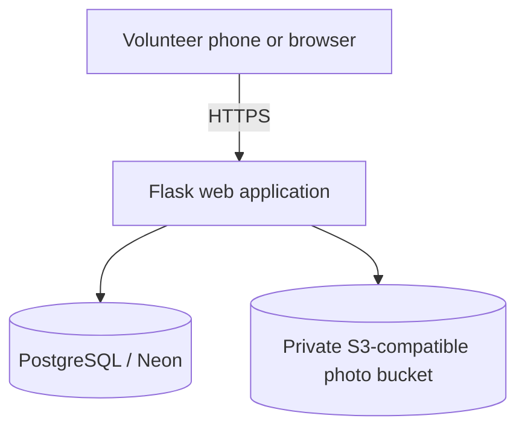

# Stock Club

**A mobile-first inventory web app for a sports club.** Stock Club helps volunteers catalogue equipment, organise it in a flexible category tree, attach photos, and track equipment loans and returns.

> The user interface is currently in French, for the club's volunteers. The code and this project overview are documented in English for a broader developer audience.

## Why this project?

Sports clubs often manage equipment through spreadsheets, paper lists, or informal messages. Stock Club brings the inventory into one shared, phone-friendly web app.

## Features

- **Flexible category tree:** create, rename, move, and organise branches at any depth.
- **Visual inventory:** equipment records include a photo, description, quantity, condition, and storage location.
- **Photo upload:** validates and re-encodes supported images as WebP; EXIF metadata is removed during conversion.
- **Borrow/return history:** records quantity changes, reason, timestamp, and the responsible volunteer.
- **Shared access:** login-based accounts managed by an administrator through Flask CLI commands.
- **Mobile-friendly UI:** responsive layout and installable PWA manifest.
- **Storage separation:** SQL database for structured data and S3-compatible object storage (e.g. Cloudflare R2) for photos in hosted deployments.
- **Database migrations and tests:** schema changes managed with Flask-Migrate/Alembic; automated tests included.

## Tech stack

- Python 3.12+
- Flask, Flask-Login, Flask-WTF
- Flask-SQLAlchemy and Flask-Migrate/Alembic
- PostgreSQL for shared hosted use; SQLite for local development
- Pillow for image validation and conversion
- boto3 for S3-compatible object storage
- Gunicorn for production serving
- HTML, CSS, JavaScript, and a lightweight PWA setup

## Architecture



For local development, SQLite and a local uploads folder are used by default. For hosted use, use a managed PostgreSQL database and persistent object storage; do not rely on the web server's ephemeral filesystem for inventory data or photos.

## Run locally

Python 3.12 or a compatible Python 3.11+ version is recommended.

### 1. Create an environment and install dependencies

Windows PowerShell:

```powershell
python -m venv .venv
.\.venv\Scripts\Activate.ps1
python -m pip install --upgrade pip
pip install -r requirements.txt
```

macOS/Linux:

```bash
python -m venv .venv
source .venv/bin/activate
python -m pip install --upgrade pip
pip install -r requirements.txt
```

### 2. Create local configuration

Windows PowerShell:

```powershell
Copy-Item .env.example .env
notepad .env
```

macOS/Linux:

```bash
cp .env.example .env
```

Set `SECRET_KEY` in `.env` to a random value. Generate one with:

```bash
python -c "import secrets; print(secrets.token_hex(32))"
```

Never commit `.env` or any real credentials. `.env.example` contains placeholders only.

### 3. Initialise the database and create a user

```bash
python -m flask --app run.py db upgrade
python -m flask --app run.py create-user
```

The CLI prompts for a login and a password of at least six characters. Create additional volunteer accounts with the same command.

### 4. Start the development server

```bash
python -m flask --app run.py run --debug
```

Open <http://127.0.0.1:5000> in a browser.

## Run tests

```bash
python -m pytest -q
```

## Deployment

A sample Render Blueprint is included in `render.yaml`, and `DEPLOYMENT.md` describes a deployment using Render, Neon PostgreSQL, and Cloudflare R2.

Before deploying:

1. Configure a strong, private `SECRET_KEY` (Render can generate it through the Blueprint).
2. Set `DATABASE_URL` to your managed PostgreSQL connection string with TLS enabled.
3. Configure the R2/S3 endpoint, bucket, and credentials as environment variables in the hosting provider.
4. Keep the bucket private and use signed photo URLs unless a deliberate public-photo policy is chosen.
5. Configure and test database and photo backups, plus restoration.
6. Run the migration against the intended database before first use.

## Security and privacy

- Do not commit `.env`, database files, photo uploads, backup archives, access tokens, or passwords.
- Never place production secrets in source code, documentation, screenshots, or GitHub Actions logs.
- The repository contains configuration templates only; real deployment values belong in the hosting provider's secret/environment settings.
- The application has not undergone an independent security audit. Review the deployment configuration and backup/recovery process before relying on it for operational club data.

## Project status

Built iteratively around feedback from club-use testing. The app is designed for the club's current inventory workflow; future extensions could include individual asset tracking, QR labels, or loan due dates.

## License

No license has been added yet. Choose a license before granting others explicit permission to reuse, modify, or redistribute the code.
